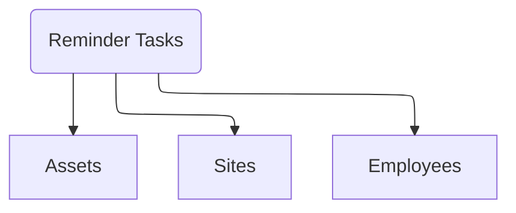

# Opus KB page format — full reference

Annotated breakdown of every convention, with copy-pasteable snippets. Read this
before authoring a page. All examples are drawn from the real published pages in
`docs/pages/`.

## Table of contents

- [Page skeleton](#page-skeleton)
- [Frontmatter keys](#frontmatter-keys)
- [The "Written for" line](#the-written-for-line)
- [The UUID spans](#the-uuid-spans)
- [Steps](#steps)
- [Images](#images)
- [Video embeds](#video-embeds)
- [Admonition types](#admonition-types)
- [Label pills](#label-pills)
- [Tabs](#tabs)
- [Mermaid diagrams](#mermaid-diagrams)
- [Grids (multi-column layouts)](#grids-multi-column-layouts)
- [Buttons](#buttons)
- [Nav-link blocks](#nav-link-blocks)
- [Inline formatting](#inline-formatting)
  - [Emphasis: what to reach for](#emphasis-what-to-reach-for)
  - [Inline icons](#inline-icons)
- [Definition lists](#definition-lists)
- [Tables](#tables)
- [Hiding the title / a heading](#hiding-the-title--a-heading)
- [Links](#links)
  - ["Get in touch" — support widget vs sales page](#get-in-touch--support-widget-vs-sales-page)
- [Registering in the nav](#registering-in-the-nav)

> **Component coverage.** The authoring extension (More Buttons) can emit each of
> these block types: admonition (`step`/`outline`/`info`/…), capture (image pair),
> **video**, **content tabs**, **data table**, **grid**, **button**, **nav-links**,
> **code block** (incl. `mermaid`), and the inline **label pill**. The sections
> below mirror that set one-for-one — if you're reaching for a layout and don't
> see it here, it isn't a supported component. Every *block* the extension emits
> carries a `data-uuid` span; match the placement rules per block. (Label pills
> are inline, so they never carry their own span.)

---

## Page skeleton

```markdown
---
icon: lucide/square-plus
tags:
  - Managing OCC
---

# Adding a contractor
<span data-uuid="3fc2a090-7aed-40b1-a4e2-713bceeef145" style="display:none"></span>

Optional intro paragraph. Use **bold** for the system name on first mention and
to call out important assumptions, e.g. **This guide assumes the employee
record already exists.**

## A section heading
<span data-uuid="cc7b8fc7-a224-4187-9f4f-d952a5917fc1" style="display:none"></span>

...content...
```

- The frontmatter is normally just `icon:` + `tags:`. There is **no `title:` key**;
  the H1 is the title, and there is exactly one H1.
- **Nothing is hand-authored between the H1's UUID span and the intro paragraph.**
  The "Written for" audience line is generated at build time — see
  [The "Written for" line](#the-written-for-line). Do not write it into the page.
- Use `##` for sections (e.g. "Manager Steps", "User Steps"), `###` below that.

## Frontmatter keys

Only these keys appear on real pages. Anything else is not a convention here.

| Key | Value | Notes |
| :--- | :--- | :--- |
| `icon` | `lucide/<name>` | [Lucide](https://lucide.dev) name, prefixed `lucide/`. Pick one that matches the topic. Present on every guide. |
| `tags` | YAML list | One *audience* tag + optional free tags. See below. |
| `search` | `exclude: true` | Keeps the page out of the search index. **Every page in `docs/drafts/` carries this** — a draft must not be findable. |
| `hide` | YAML list | Strips page chrome. Overview/landing pages only. See below. |
| `status-page` | `true` | `system-status.md` only. Never on a guide. |

```yaml
---
icon: lucide/key-round
tags:
  - Managing OCC
search:
  exclude: true
---
```

### `tags:`

A YAML list. Almost every guide carries exactly **one** *audience* tag — the
reserved trio the extension's "Written for" radio writes:

- `Using OCC` — users and above
- `Managing OCC` — managers and above
- `Administering OCC` — administrators only

Then, optionally, free tags: `Add-on`, `Overview`, `System`, `RAMS`. Tags must
already exist in the registry in `zensical.toml` (`[project.extra]
mb_created_tags`); adding a brand-new tag means adding it there too.

### `hide:`

Optional; strips page chrome. Used on landing/overview pages like
`contractors-overview.md`, `rams-overview.md`, `employees-overview.md`. Valid
entries: `toc` (right-hand table of contents), `navigation` (left sidebar),
`path` (breadcrumb), and `written-for` (suppresses the generated audience line).
Most how-to pages omit `hide:` entirely.

```yaml
---
icon: lucide/layout-dashboard
tags:
  - Managing OCC
  - Overview
hide:
  - navigation
  - toc
  - path
  - written-for
---
```

## The "Written for" line

A line of role pills reading **Written for · Managers · Administrators** sits
directly under the page H1 on every guide that has an audience tag.

**Do not author it.** It is rendered at build time by
`overrides/partials/content.html` from the page's audience tag, against the
ordered `[project.extra] mb_audiences` registry in `zensical.toml`. The page
carries only the tag; the tag is the single source of truth.

- The audience is the **first** `mb_audiences` entry whose `tag` appears in the
  page's `tags:`, and the line shows that entry **plus every later one** — hence
  "managers and above". `Managing OCC` → Managers + Administrators.
- No audience tag → no line. `hide: [written-for]` → no line.
- Styling lives in `docs/assets/stylesheets/written-for.css`; pill colours come
  from `labels.css`.

> **Legacy — do not reproduce.** Older revisions of these pages carried a
> hand-written block (`<span data-mb-suitable-for …>` + a "This guide is suitable
> for: …" line) under the H1. That has been removed from every page and replaced
> by the build-time line. Writing one now produces a **duplicate** audience line.
> If you find one in an old file, delete it and check the `tags:` are right.

## The UUID spans

The defining trait of these pages. A hidden span identifies each **heading and
component block** so an external system (the authoring extension) can track and
round-trip it:

```html
<span data-uuid="0b56cc37-8f57-4752-be92-db07bbe31680" style="display:none"></span>
```

What gets a span: the H1, every `##`/`###` heading, and every component block —
each admonition (`!!! step`, `!!! outline`, `!!! info`, …), each capture/image
group, each **video** group, each data table, each content-tab group (plus one
per tab), each **grid** (plus one per grid cell), each **button**, and each
**nav-links** block. **Plain prose paragraphs do not get a span** — they're part
of their heading's section.

Placement is exact — the extension generates these and reads them back, so match
it precisely:

- **Heading:** span on the line *directly under* the heading, then a blank line:
  ```markdown
  ## A section heading
  <span data-uuid="..." style="display:none"></span>

  body...
  ```
- **Admonition (step/outline/info/…):** the span is the *first line inside* the
  block, followed by a **blank line**, then the content. (The blank line stops a
  capture/table that follows from "stealing" the admonition's UUID.) The blank
  line also matters for **rendering**: if the content is a `- ` list or a `|`
  table and there's no blank line after the span, Markdown treats those lines as
  a continuation of the span's paragraph and renders them as run-on prose with
  literal `- ` characters — the build won't flag it, but `lint.py` warns.
- **Capture/image group:** the span is on the line *immediately before* the
  `` lines — **no** blank line between the span and the images — with a
  blank line before the span.
- **Data table:** span, then a **blank line**, then the pipe table.
- **Content tabs:** the group span goes on the line *immediately before* the
  first `=== "Title"`; each tab carries its own span as the first line of its
  indented body.
- **Video:** like a capture — span on the line *immediately before* the first
  `<video>` tag (no blank line between).
- **Grid:** the grid span sits *immediately before* the `<div class="grid"
  markdown>` line; each cell's span is the *first content line inside* its
  `<div markdown>` (blank line above and below it — the cell is parsed as
  `md_in_html`, so its body is **not** indented).
- **Button / nav-links:** span on the line *immediately before* the `[label](…)`
  link / the `<div class="mb-nav-links" …>` line.

Rules:
- Every UUID is a fresh, unique v4. Never reuse one across blocks, pages, or from
  this skill's examples — duplicates defeat the tracking they exist for.
- Generate them in bulk: `python3 scripts/uuids.py 40`.

Pages with lots of small blocks legitimately have 40–100 of these. Don't be shy
generating extra; unused lines are harmless.

## Steps

Procedures are runs of the custom `!!! step` admonition — never an ordered list.
Each step is indented 4 spaces and typically contains: a UUID span, the
instruction, a second UUID span, then the light/dark screenshot pair.

```markdown
!!! step

    <span data-uuid="..." style="display:none"></span>
    From the site inbox, click the **Switch to Manage Mode** button.

    <span data-uuid="..." style="display:none"></span>
    { style="height: 50px" loading=lazy }
    { style="height: 50px" loading=lazy }
```

- **Steps auto-number.** Writing `!!! step` (no title) renders as "Step 1",
  "Step 2", … — the count is generated by CSS and **resets at every `##`**, so
  never type the number yourself. Use a plain `!!! step`.
- **Subtitled steps** carry a `.meta` subtitle via the quoted-title form (the
  number is still auto-generated above it):
  ```markdown
  !!! step "<span class="meta">(optional)</span>"
  ```
- Steps can also be collapsible: `??? step` (collapsed) / `???+ step` (open).
- Bold every clickable label: **Switch to Manage Mode**, **+New**, **Save
  contractor**.
- Steps can nest other admonitions (a `!!! outline` per form field, a
  `??? info` explaining a choice, a `!!! warning` for a gotcha) — indent them a
  further 4 spaces.
- A step can contain a numbered sub-list when there are genuine alternatives
  ("either scan the QR code, or copy the link"):
  ```markdown
      1. Ask the employee to scan the QR code with their phone.
      2. Copy the link and send it via email or Teams/Slack.
  ```

### `!!! outline` for form fields

When a step is "fill in these fields", list each field as an `!!! outline`:

```markdown
    !!! outline "Contractor name"

        <span data-uuid="..." style="display:none"></span>

        <span data-uuid="..." style="display:none"></span>
        
        

    !!! outline "Photo<span class="meta">(optional)</span>"
        ...
```

Use `<span class="meta">(optional)</span>` / `(recommended)` after a field title
to annotate it.

## Images

Always a light/dark pair, mirroring the app's nav path under `occ-captures/`:

```markdown
{ style="height: 50px" loading=lazy }
{ style="height: 50px" loading=lazy }
```

- `#only-light` / `#only-dark` are Material's
  [light/dark image](https://squidfunk.github.io/mkdocs-material/reference/images/)
  filters; the theme swaps them with the colour scheme.
- Filenames end `-light-mode.png` / `-dark-mode.png`.
- Sizing by role (the extension emits one of three modes — `height`, `width`, or
  none):
  - status icons in tables → `{ style="height: 30px" loading=lazy }`
  - small chips/buttons → `{ style="height: 50px" loading=lazy }`
  - list/table thumbnails → `{ width="200" loading=lazy }`
  - forms/dialogs → `{ width="400" loading=lazy }` (also `width="500"`)
  - hero/full-bleed captures → `{ width="900" loading=lazy }`, `loading=lazy`
    only, or nothing.
- **Rounded corners:** add `border-radius: 8px` to the `style=` for hero/feature
  images, e.g. `{ style="border-radius: 8px" width="900" loading=lazy }`.
- **Inversed pair (advanced):** normally `-light-mode.png` carries `#only-light`.
  A few feature/overview captures deliberately *swap* them — the `-light-mode`
  file is tagged `#only-dark` and vice-versa — so the lighter-looking asset shows
  in dark mode. Only do this if you're matching an existing inversed block; the
  default is light↔light, dark↔dark.
- `uuid` and `id` appear literally in some paths as placeholders for per-record
  segments — keep that convention.
- Filenames are usually `.png` screenshots. Shared **icon** assets (task
  severities, task-type glyphs) are `.svg` under `occ-captures/other/` and follow
  the same `-light-mode` / `-dark-mode` pairing, typically at
  `{ style="height: 30px" loading=lazy }` inside a table cell.
- Nearly all images live under `docs/assets/media/occ-captures/<app-area>/…`.
  The app areas, by capture count: `admin` (much the largest), `todos`, `sites`,
  `employees`, `other` (shared icons), `dashboard`, `users`, `contractors`,
  `projects`, `my`. `docs/assets/media/other/` — the sibling of `occ-captures`,
  not `occ-captures/other/` — is legacy/animation assets; don't add to it.
- **Reuse, don't invent.** Search the `occ-captures` tree for an existing pair
  that fits the step before writing a path. If none fits, omit the image for that
  step and list it for the user — never fabricate a placeholder path.

## Video embeds

The extension has a **video** component for short demo clips. It emits raw
`<video>` tags (a light/dark pair, same `#only-light`/`#only-dark` convention as
images), **not** Markdown. Two playback modes:

- **Animation** (silent looping GIF-replacement): `autoplay loop muted playsinline
  preload="none"`.
- **Clip** (user-controlled): `controls playsinline preload="metadata"` (no
  autoplay/loop/muted).

```markdown
<span data-uuid="..." style="display:none"></span>
<video src="../assets/media/videos/contractor-tile-light-mode.mp4#only-light" autoplay loop muted playsinline preload="none" style="border-radius: 8px"></video>
<video src="../assets/media/videos/contractor-tile-dark-mode.mp4#only-dark" autoplay loop muted playsinline preload="none" style="border-radius: 8px"></video>
```

- The UUID span sits on the line *immediately before* the first `<video>` (like a
  capture).
- Size with `style="width: …px"` / `style="height: …px"`; add `border-radius:
  8px` to round.
- A single, theme-agnostic video drops the `#only-*` fragment and emits one tag.
- Videos live under `docs/assets/media/videos/` (not `occ-captures/`). As with
  images, **don't invent a path** — reference an existing file or leave it out
  and list it for the user.
- The same inversed light/dark swap as images can apply (e.g.
  `…-light-mode.mp4#only-dark`); only mirror an existing block.

## Admonition types

The extension's admonition picker offers exactly these types: `step`, `outline`,
`note`, `abstract`, `info`, `tip`, `success`, `question`, `warning`, `failure`,
`danger`, `bug`, `example`, `quote`. (The `status-*`, `feature-release`,
`improvement` and `new-addition` types below are styled for the **system-status /
system-updates** pages only and aren't in the general picker — don't use them on
a normal guide. The `status-*` ones also read `data-mb-start`/`data-mb-end` (or
`data-mb-reported`/`data-mb-resolved`) attributes on their UUID span to drive the
site-wide status banner; that machinery is system-status-only.)

Standard Material admonitions accepted by the tool: `note`, `abstract`, `info`,
`tip`, `success`, `question`, `warning`, `failure`, `danger`, `bug`, `example`,
`quote`. Custom types defined in `docs/assets/stylesheets/admonitions.css`:

| Type | Use for |
| :--- | :--- |
| `step` | A numbered procedure step (the workhorse). |
| `outline` | A form field within a step. |
| `status-available` | Service operational (system-status page). |
| `status-disruption` | Partial/degraded service. |
| `status-maintenance` | Planned maintenance window. |
| `status-outage` | Service down. |
| `feature-release` | A new feature announcement. |
| `improvement` | An enhancement to existing behaviour. |
| `new-addition` | Newly added capability. |

Syntax:
- `!!!` = always-open block. `???` = collapsible (collapsed). `???+` = collapsible, open by default.
- Optional quoted title: `!!! warning "Don't skip this step!"`. Omit for a
  default title.

```markdown
!!! tip "No Account? Try Temporary Access"

    <span data-uuid="..." style="display:none"></span>
    Interested in a quick way for employees to complete requirements without an
    account? [Explore Temporary Access](...) for secure, time-limited access.

??? info "When to select Yes"

    <span data-uuid="..." style="display:none"></span>
    Selecting `Yes` means:

    - You will always receive ongoing task reminders...

    **^^Recommended for:^^** Contractors who are regularly used.
```

## Label pills

The most-used inline component on these pages (200+ occurrences). A **label pill**
is a coloured inline badge — the extension emits raw HTML, which `md_in_html`
renders:

```markdown
<span class="mb-label mb-label-red">Immediate</span>
<span class="mb-label mb-label-blue">:lucide-user: User</span>
```

- Two classes, always: the base `mb-label` plus one `mb-label-<slug>` colour.
- An optional leading `:lucide-*:` icon shortcode goes **inside** the span, before
  the text, separated by a space.
- Pills are **inline**, so they never take their own `data-uuid` span — they
  belong to whatever block contains them.
- Palette slugs (defined in `docs/assets/stylesheets/labels.css`) — chromatic:
  `red orange amber yellow lime green emerald teal cyan sky blue indigo violet
  purple fuchsia pink rose`; neutrals: `slate grey zinc neutral stone taupe mauve
  mist olive`. Same slugs as the button colour variants.

Where the pages use them:

- **Enum / status values in tables** — a severity, a status, a task kind:
  `| … | <span class="mb-label mb-label-red">Critical</span> | … |`. Note this is
  the pill treatment, *not* backticks; see [Inline formatting](#inline-formatting)
  for when to use which.
- **Access levels** — these have a **fixed colour + icon** across the KB, set by
  `access-and-authorisations.md` and mirrored by the `mb_audiences` registry in
  `zensical.toml` (which drives the "Written for" line). Reuse them exactly;
  don't invent a new colour for a level that already has one:

  | Level | Pill |
  | :--- | :--- |
  | User | `<span class="mb-label mb-label-blue">:lucide-user: User</span>` |
  | Manager | `<span class="mb-label mb-label-purple">:lucide-user-shield: Manager</span>` |
  | Administrator | `<span class="mb-label mb-label-pink">:lucide-user-cog: Administrator</span>` |

- **Other categories in prose and lists** — pick a slug and keep it stable for
  that value across the page (and across pages, if it already has one).
- **Admonition titles**, to badge a step or an outline:
  `??? outline "<span class="mb-label mb-label-slate">Step 1: Site Setup</span>"`.
- **Eyebrow text** above a heading in an overview grid cell:
  `<span class="mb-label mb-label-slate">Smarter management, built for compliance</span>`.
- **Colour-coding a sequence** — e.g. `onboarding-process.md` runs phases through
  `orange → yellow → lime → emerald` and reuses the same colour for each phase's
  heading and its bullet in the summary list. **Keep a value's colour consistent
  across the whole page** (and, where it already exists, across pages).

Related: `[project.extra.nav_labels]` in `zensical.toml` puts the same pills next
to sidebar nav titles (e.g. an `Add-on` badge on "Contractors"). That is config,
not page content — don't author nav pills into a page.

## Tabs

For branching paths (new vs existing user, etc.) use content tabs:

```markdown
<span data-uuid="..." style="display:none"></span>
=== "New Opus User"

    <span data-uuid="..." style="display:none"></span>
    **Follow the steps below to create a new Opus account.**

    !!! step
        ...

=== "Existing Opus User"

    !!! step
        ...
```

## Mermaid diagrams

Fenced ```` ```mermaid ```` code blocks are enabled (`zensical.toml` →
`pymdownx.superfences` custom fence) and are used on the concept pages —
`types-of-task.md`, `contractor-and-project-statuses.md`,
`permits-to-work.md` — usually inside a content tab that offers a "Diagram" view
alongside a prose or table view.

````markdown
<span data-uuid="..." style="display:none"></span>

````

- It is a **code block**, so it takes a UUID span on the line immediately before
  the opening fence (like a capture).
- The existing diagrams open with the `config: layout: elk` frontmatter for the
  ELK layout engine and use `flowchart TB`. Match that unless there's a reason
  not to.
- Inside a tab or admonition, indent the whole fence 4 spaces with the rest of
  the body.
- Prefer a diagram only where the relationships genuinely branch; a table or a
  definition list is the better default for flat value → meaning content.

## Grids (multi-column layouts)

For side-by-side content (feature tiles, text-beside-screenshot) the extension
emits a **grid**: a `<div class="grid" markdown>` wrapper holding two or more
cell `<div … markdown>`s. Because each div has the `markdown` attribute, its body
is parsed as Markdown — but as `md_in_html`, so cell bodies are written at column
0 (**no indentation**) with blank lines separating the tags from content.

```markdown
<span data-uuid="..." style="display:none"></span>
<div class="grid" markdown>

<div style="align-self: center" markdown>

<span data-uuid="..." style="display:none"></span>
`Smarter management, built for compliance`

# Opus Contractor Management

Body copy for the left cell.

<span data-uuid="..." style="display:none"></span>
[Contact us :lucide-send:](https://www.opus-safety.co.uk/contact){ .md-button .md-button--primary target="_blank" rel="noopener" }

</div>

<div class="spill" style="align-self: center" markdown>

<span data-uuid="..." style="display:none"></span>
{ style="border-radius: 8px" width="900" loading=lazy }
{ style="border-radius: 8px" width="900" loading=lazy }

</div>

</div>
```

- **Grid span** immediately before `<div class="grid" markdown>`; **each cell**
  gets its own span as the first content line *inside* its div.
- **Cell flavors:** a plain `<div markdown>` (generic) or `<div class="card"
  markdown>` (boxed card). Cells can mix.
- **`spill`** (`class="spill"` / `class="card spill"`) lets a cell — usually an
  image — bleed past the grid gutter for a fuller-bleed look.
- **Vertical alignment** per cell via `style="align-self: start"` (top) /
  `center` / `end` (bottom).
- Cells can hold **any** component — `!!! outline` tiles with a `<video>` inside
  are the common feature-grid pattern (see `contractors-overview.md`).

## Buttons

A **button** is a Markdown link with Material's `.md-button` class. Use for
primary calls-to-action ("Contact us", "Get started"), not ordinary inline links.

```markdown
<span data-uuid="..." style="display:none"></span>
[Contact us :lucide-send:](https://www.opus-safety.co.uk/contact){ .md-button .md-button--primary target="_blank" rel="noopener" }
```

- `.md-button` = secondary; add `.md-button--primary` for the filled primary
  style.
- **Colour variants**: add `.custom-button-<slug>` alongside `.md-button` for a
  button tinted with the label colour set (same slugs and colours as
  `.mb-label-<slug>`), e.g. `{ .md-button .custom-button-emerald }`. Do not combine
  with `.md-button--primary`. Slugs — chromatic: `red orange amber yellow lime
  green emerald teal cyan sky blue indigo violet purple fuchsia pink rose`;
  neutrals: `slate grey zinc neutral stone taupe mauve mist olive`.
- Append `target="_blank" rel="noopener"` to open in a new tab (external links).
- **Inline icons** use the `:icon-name:` shortcode — Lucide icons are
  `:lucide-send:`, `:lucide-arrow-right:` (the `lucide/send` path with the slash
  turned into a dash). These work in any inline text, not just buttons.

## Nav-link blocks

A **nav-links** block renders an auto-generated list of child links for a branch
of the site nav — used at the foot of overview pages to point at the guides under
that section. It's an empty div the theme fills at build time from `zensical.toml`:

Two flavours — **path mode** and **tag mode**:

```markdown
<span data-uuid="..." style="display:none"></span>
<div class="mb-nav-links" data-nav-path="guides/contractors"></div>

<span data-uuid="..." style="display:none"></span>
<div class="mb-nav-links" data-nav-tag="Using OCC, Managing OCC" data-nav-layout="grouped"></div>
```

- **`data-nav-path`** — a nav branch to list (e.g. `guides/contractors`,
  `guides/rams`). Renders that section as a heading over its page buttons.
- **`data-nav-tag`** — a **comma-separated** list of tags; a page matches when its
  frontmatter carries **any** of them. Pair it with `data-nav-layout`:
  - `grouped` — the nav hierarchy, filtered to matching pages (only branches
    containing a match survive).
  - `flat` — a bare button stack, no group headings.
- **`data-nav-new-tab="true"`** *(optional, either flavour)* — makes the block's
  links open in a **new tab** (`target="_blank" rel="noopener"`, arrow-up-right
  icon). **Omit it for the default**: links open in the same tab with the
  arrow-right icon. The runtime picks the icon — never hand-write one. Set via
  the extension's nav-links form ("Open in new tab?").
- **Always leave the div empty** — do not hand-write links inside. It's filled at
  runtime by `docs/assets/javascripts/nav-links.js` from the nav tree baked into
  every page, so editing `zensical.toml` or a page's tags updates every list
  without touching the pages that reference them.
- A placeholder that matches nothing renders a **visible error line**, so a typo
  in a path or tag is loud, not silent.

## Inline formatting

- `**bold**` — UI labels, buttons, key warnings, system name on first mention.
  **This is the default emphasis on these pages.** When you want a phrase to
  land, bold it.
- `*italic*`, `***bold italic***` — softer emphasis; also asides and quoted
  question text (*"Are all fire doors closed?"*).
- `` `backticks` `` — literal values typed or chosen by the user: `Yes`, `No`,
  a field value, a filename. Also fine for enum names in running prose.
- **[Label pill](#label-pills)** — the preferred treatment for a *named status,
  severity, category or access level* being presented as a value in its own
  right, especially in tables and lists: `<span class="mb-label mb-label-red">Critical</span>`.
  Rule of thumb: backticks for "type this", a pill for "this is a thing the
  system shows you". Don't wrap a pill in backticks.
- `^^underline^^` — underline / inserted text (`<ins>`, via `pymdownx.caret`).
  **Not for emphasis** — the user prefers `**bold**` or `*italic*` for
  emphasising phrases and key terms, so never underline those. Its one
  sanctioned use is the `^^**Recommended for:**^^` lead-in already on published
  pages. (Note: it renders underlined, **not** highlighted.)
- `~~strikethrough~~` — deleted text.
- `<span class="meta">(optional)</span>` — muted annotation after a field title.
- **[Inline icon](#inline-icons)** — `:lucide-name:`, see below.
- `---` on its own line — horizontal rule (used to frame email templates and
  separate hero sections on overview pages).

### Emphasis: what to reach for

**`==highlight==` is not house style — don't use it.** `pymdownx.mark` is
enabled, so it renders, but it appears **zero times** across every published
page in `docs/pages/`. A page peppered with `==…==` is instantly identifiable as
not belonging. It reads as a highlighter pen scribbled over the copy, and
because it's applied to whole clauses it flattens the very emphasis it's meant
to create.

Reach for these instead, in rough order of how often they're the right answer:

| Want to… | Use |
| :--- | :--- |
| Stress a phrase, a limit, a caveat | `**bold**` |
| Name a UI label, button or menu path | `**bold**` |
| Introduce a key term on first mention (*responsive design*, *plus addressing*) | `**bold**` — never `^^underline^^` |
| Soften an aside, or quote a question the UI asks | `*italic*` |
| Flag a lead-in like "Recommended for:" | `^^**Recommended for:**^^` (the only place `^^…^^` is used) |
| Present a *named* status / severity / access level / category | [label pill](#label-pills) |
| Show a literal value the user types or picks | `` `backticks` `` |
| Give a warning, restriction or gotcha its own weight | a `!!! warning` / `!!! note` [admonition](#admonition-types), not inline emphasis |

If a sentence feels like it needs highlighting to be noticed, that is usually a
sign it should be **its own admonition** rather than a marked-up clause buried
in a paragraph.

### Inline icons

`:lucide-name:` renders any [Lucide](https://lucide.dev) icon inline, anywhere
inline text is allowed — prose, list items, table cells, admonition titles,
label pills, button labels. The slash in a `lucide/x` path becomes a dash, so
`lucide/user-cog` → `:lucide-user-cog:`. Names must exist in the theme's icon
set (`zensical/templates/.icons/lucide/*.svg`); an unknown name renders as
literal text, and the build does **not** warn.

They are genuinely useful for signposting — use them where they carry meaning,
not as decoration. The established patterns:

- **Naming an unlabelled control in a step** — the single most useful case. When
  the button has an icon and no text, show the icon rather than describing it:
  ```markdown
  Click the :lucide-ellipsis: icon to open the more options menu.
  ```
- **Inside a label pill**, as the value's fixed glyph (see
  [Label pills](#label-pills) for the access-level set):
  ```markdown
  <span class="mb-label mb-label-purple">:lucide-user-shield: Manager</span>
  ```
- **A tick in a comparison table** — `:lucide-check:` marks the cells where a
  capability applies (`access-and-authorisations.md` uses ~50 of them):
  ```markdown
  | Complete their own requirements | :lucide-check: | :lucide-check: | :lucide-check: |
  ```
- **Prefixing a short aside**, to tag who it applies to:
  ```markdown
  :lucide-user: *Those with user access can only snooze tasks if they're assigned.*
  ```
- **In a button label**, trailing the text: `[Contact us :lucide-send:](…){ .md-button }`,
  `[Subscribe here :lucide-bell-ring:](…){ .md-button }`.

Keep an icon's meaning **consistent within a page** — the same glyph shouldn't
mean two things — and prefer the icon the app itself uses for that control.

## Definition lists

For explaining a set of enum/role values, the pages use Markdown definition
lists (`pymdownx`-enabled): the term on its own line, then `:` + three spaces +
the definition. Common inside a `!!! step` that sets an access level or status:

```markdown
    `user`
    :   Can fulfil employee-scoped tasks such as their own e-learning completion.

    `manager`
    :   Can change their own requirements and deal with their own confidential tasks.

    `administrator`
    :   Can make administrative-level changes to the employee record.
```

- Term is typically a `` `backticked` `` enum value; the definition line starts
  with `:` then **three spaces**.
- This is a lightweight alternative to a two-column table when you just need
  value → meaning. The definition list is **part of its step/heading's section**,
  so it doesn't take its own UUID span.

## Tables

GitHub-style pipe tables; status/enum cells in backticks. The authoring
extension has a dedicated **Data Table** component, so match what it emits:

```markdown
<span data-uuid="..." style="display:none"></span>

| Status | Description |
| :--- | :--- |
| `Ready` | All requirements fulfilled and up to date. Ready for use. |
| `Archived` | Archived from the edit page; no new tasks generated. |
```

- The UUID span sits on its own line with **one blank line** before the table
  (unlike most blocks, where the span hugs its content).
- **Column alignment** is set by the divider row's colons: `:---` left,
  `:---:` centre, `---:` right (`---` works as a fallback). Cells themselves are
  written `| value |` — a space after the opening `|` and before the closing `|`.
- A literal pipe inside a cell must be **escaped** as `\|`.
- **Cells can contain captures.** Inside a cell, a light/dark pair is written
  *inline on the one line* (not the usual two-line block form):
  ```markdown
  | <span data-uuid="..." style="display:none"></span>  | … |
  ```
- `tablesort` is loaded globally (`zensical.toml` → `extra_javascript`), so
  column headers become sortable automatically.

**`nowrap-first` wrapper (opt-in).** When the first column shouldn't wrap — a
short status word breaking onto two lines, or an icon capture being squeezed —
wrap the table in `<div class="nowrap-first" markdown>`. The column then sizes to
its content. The UUID span stays outside the wrapper, with a blank line before
the div, and the table sits inside with blank lines around it:

```markdown
<span data-uuid="..." style="display:none"></span>

<div class="nowrap-first" markdown>

| Icon | Severity | Description |
| :--- | :--- | :--- |
| <span data-uuid="..." style="display:none"></span>{ style="height: 30px" loading=lazy } { style="height: 30px" loading=lazy } | <span class="mb-label mb-label-red">Critical</span> | High priority tasks such as incidents. |

</div>
```

This is the standard shape for the icon + label + description reference tables
(`task-severities.md`, `types-of-task.md`): an SVG capture pair in column one, a
[label pill](#label-pills) in column two, prose in column three.

## Hiding the title / a heading

Overview/landing pages sometimes need a heading present in the document (so the
nav and the UUID structure stay intact) but **hidden** on the rendered page. The
extension does this with a tiny inline `<style>` marker rather than CSS in a
stylesheet:

- **Hide a section heading** — place this *after* the heading's UUID span (with a
  blank line), and the `:has()` selector hides the preceding `h1`/`h2`/`h3`:
  ```markdown
  ## -
  <span data-uuid="..." style="display:none"></span>

  <style data-mb-hide-section-title>:is(h1,h2,h3):has(+ p + style[data-mb-hide-section-title]){display:none}</style>
  ```
  (A `## -` placeholder heading + this marker is how `contractors-overview.md`
  inserts an unlabelled section divider.)
- **Hide the page H1** — the same marker on the line under the H1's UUID span
  (the legacy `data-mb-hide-title` preamble marker is migrated to this by the
  extension). This is what `contractors-overview.md` does: frontmatter, H1, its
  span, then the `<style>` marker, then the first grid.

Only reach for these on overview pages that are deliberately chrome-light; normal
guides show their headings.

## Links

- Internal links between guides use the **deployed absolute URL**, e.g.
  `https://support.opus-safety.co.uk/pages/granting-an-employee-temporary-access/`.
  That is what the published pages use — match them.
- **Avoid relative `.md` links.** A draft linking to `interacting-with-a-task.md`
  resolves relative to `docs/drafts/`, not `docs/pages/`, so it breaks and
  `zensical build` reports "page does not exist". Two drafts currently have this
  bug. The absolute URL sidesteps it entirely and survives promotion.
- App deep-links point at `https://cloud.opus-safety.co.uk/...`.
- Bold the surrounding action when the link is a button.

### "Get in touch" — support widget vs sales page

There are **two** different destinations, and they are not interchangeable.
Getting this wrong sends a customer with a broken feature to a sales form.

**System support — the default.** Anything about using, fixing, configuring or
enabling something in Opus Compliance Cloud opens the in-page support
widget (Help Scout Beacon, called only through the vendor-neutral
`window.supportWidget` shim in `support-widget.js` — never the vendor API). It's a raw anchor, because it calls JS rather than navigating:

```markdown
<a href="#" onclick="event.preventDefault(); window.supportWidget.open();">get in touch</a>
```

As a button (`system-updates.md`, `index.md`):

```markdown
[Submit a support ticket](#){ .md-button onclick="window.supportWidget.toggle(); return false;" }
```

**Sales enquiries only** — buying a module or add-on, pricing, a demo, a new
contract — link the marketing site:

```markdown
[Contact us :lucide-send:](https://www.opus-safety.co.uk/contact){ .md-button .md-button--primary target="_blank" rel="noopener" }
```

In practice `/contact` appears only as the CTA button on the add-on **overview**
pages (`contractors-overview.md`, `rams-overview.md`). On a how-to, a concept
page or an FAQ, a "get in touch" is **almost always the support widget**.

Cases that look ambiguous but are still **support**: "speak to us and we'll
customise that checklist", "contact us to have this feature enabled on your
account", "let us know if this affects your records". Configuring or switching
on something for an existing customer is support, not a purchase.

## Registering in the nav

A page is invisible until it's listed in `zensical.toml`. There are **three** nav
keys; only `nav` is read by Zensical, the other two are bookkeeping for the
extension:

| Key | Meaning |
| :--- | :--- |
| `nav` | Published pages — built, in the sidebar, in search. |
| `draft_nav` | Work in progress under `docs/drafts/`. Pair with `search: exclude: true` in the page frontmatter. |
| `unlisted_nav` | Built and reachable by URL, but kept out of the sidebar and search (extension → Page settings → Page visibility). |

Add published pages to `nav`, drafts to `draft_nav`, nested under the right
group:

```toml
nav = [
  {"Guides" = [
    {"Contractors" = [
      {"Adding a new contractor" = "pages/adding-a-new-contractor.md"},
      {"Archiving a contractor"  = "pages/archiving-a-contractor.md"}
    ]}
  ]}
]
```

The label is what shows in the sidebar; the value is the path relative to
`docs/`.
