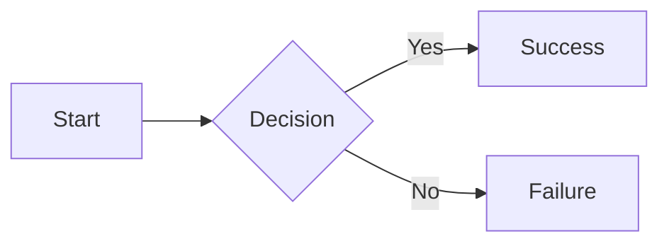

# Zensical Reference

You are helping with a Zensical documentation project. Use this skill as a reference when authoring or editing Zensical markdown files.

Zensical is a documentation site generator built on Material for MkDocs, implemented in Rust with Python callbacks for Markdown rendering. Configuration lives in `zensical.toml`.

---

## CLI Commands

```bash
zensical new [directory]                           # scaffold new project
zensical serve -f config.toml [-a host:port] [-o]  # serve locally (default: localhost:8000)
zensical build -f config.toml [-c] [-s]            # build static site
  -c / --clean   clean cache before build
  -o / --open    open browser on serve
```

Config file can be `zensical.toml` (TOML) or `mkdocs.yml` (YAML).

---

## Configuration (`zensical.toml`)

### Basic project settings

```toml
[project]
site_name = "My Site"                 # required
site_description = "..."              # optional; HTML head SEO
site_author = "Name"                  # optional
site_url = "https://example.com/"     # optional; recommended for prod
copyright = "Copyright © 2026..."     # optional; footer (HTML allowed)

docs_dir = "docs"                     # default: "docs"
site_dir = "site"                     # default: "site"
use_directory_urls = true             # default: true
dev_addr = "localhost:8000"
```

### Repository

```toml
repo_url = "https://github.com/user/repo"
repo_name = "GitHub"                  # auto-detected from repo_url
edit_uri = "edit/master/docs"         # auto-detected for GitHub/GitLab/Bitbucket
```

### Theme

```toml
[project.theme]
variant = "modern"          # "modern" (default) or "classic"
language = "en"             # 60+ supported languages
direction = "ltr"           # "ltr" or "rtl"
favicon = "assets/images/favicon.png"
logo = "assets/logo.png"    # image takes precedence over icon
custom_dir = "overrides"    # Jinja2 template overrides directory

[project.theme.font]
text = "Inter"              # modern default (classic: "Roboto")
code = "JetBrains Mono"     # modern default (classic: "Roboto Mono")

[project.theme.icon]
logo = "lucide/book-open"
repo = "fontawesome/brands/github"
edit = "lucide/file-pen"

# Customise admonition icons
[project.theme.icon.admonition]
note = "octicons/info-16"
warning = "octicons/alert-16"
# etc.
```

### Color palettes (supports multiple for light/dark toggle)

```toml
[[project.theme.palette]]
scheme = "default"                          # light
media = "(prefers-color-scheme: light)"
primary = "blue"
accent = "indigo"
toggle.icon = "lucide/sun"
toggle.name = "Switch to dark mode"

[[project.theme.palette]]
scheme = "slate"                            # dark
toggle.icon = "lucide/moon"
toggle.name = "Switch to light mode"
```

### Feature flags

```toml
features = [
    # Announcement bar
    "announce.dismiss",

    # Code
    "content.code.annotate",        # code annotations
    "content.code.copy",            # copy-to-clipboard button
    "content.code.select",          # line selection button

    # Content
    "content.footnote.tooltips",    # footnotes as inline tooltips
    "content.tabs.link",            # link same-titled tabs across page
    "content.tooltips",             # enhanced link tooltips

    # Navigation
    "navigation.footer",            # prev/next in footer
    "navigation.indexes",           # section index pages
    "navigation.instant",           # SPA/XHR navigation
    "navigation.instant.prefetch",  # prefetch on hover
    "navigation.instant.progress",  # progress indicator
    "navigation.path",              # breadcrumb
    "navigation.prune",             # reduce HTML size ~33%
    "navigation.sections",          # group top-level sections
    "navigation.tabs",              # top-level sections as header tabs
    "navigation.tabs.sticky",       # sticky tabs
    "navigation.top",               # back-to-top button
    "navigation.tracking",          # auto-update URL with active anchor
    "navigation.expand",            # expand sections by default

    # Search
    "search.highlight",

    # TOC
    "toc.follow",                   # auto-scroll TOC to active heading
    "toc.integrate",                # render TOC in sidebar

    # Header
    "header.autohide",

    # Edit/view source
    "content.action.edit",
    "content.action.view",
]
```

### Navigation

```toml
nav = [
  { "Home" = "index.md" },
  { "Section" = [
    "section/page-one.md",
    "section/page-two.md",
  ]},
  { "External" = "https://example.com" },
]
```

### Markdown extensions

All extensions enabled under `[project.markdown_extensions.*]`:

```toml
# Standard
[project.markdown_extensions.abbr]
[project.markdown_extensions.admonition]
[project.markdown_extensions.attr_list]
[project.markdown_extensions.def_list]
[project.markdown_extensions.footnotes]
[project.markdown_extensions.md_in_html]
[project.markdown_extensions.tables]

[project.markdown_extensions.toc]
permalink = true

# PyMdown
[project.markdown_extensions.pymdownx.arithmatex]
generic = true                        # enables \(...\) and \[...\] syntax

[project.markdown_extensions.pymdownx.betterem]     # smarter emphasis
[project.markdown_extensions.pymdownx.caret]        # ^^underline^^ / superscript
[project.markdown_extensions.pymdownx.details]      # ??? collapsible blocks
[project.markdown_extensions.pymdownx.emoji]        # :emoji: and icon syntax
[project.markdown_extensions.pymdownx.inlinehilite] # inline `#!python code`
[project.markdown_extensions.pymdownx.keys]         # ++ctrl+alt+del++
[project.markdown_extensions.pymdownx.magiclink]    # auto-link URLs and emails
[project.markdown_extensions.pymdownx.mark]         # ==highlight==
[project.markdown_extensions.pymdownx.smartsymbols] # (c) → © etc.
[project.markdown_extensions.pymdownx.tilde]        # ~~strikethrough~~ / subscript

[project.markdown_extensions.pymdownx.highlight]
anchor_linenums = true
line_spans = "__span"
pygments_lang_class = true

[project.markdown_extensions.pymdownx.superfences]
[[project.markdown_extensions.pymdownx.superfences.custom_fences]]
name = "mermaid"
class = "mermaid"

[project.markdown_extensions.pymdownx.tabbed]
alternate_style = true              # required
combine_header_slug = true

[project.markdown_extensions.pymdownx.tasklist]
custom_checkbox = true

[project.markdown_extensions.pymdownx.blocks.caption]
```

### Extra assets and social

```toml
extra_css = ["stylesheets/extra.css"]
extra_javascript = [
    "javascripts/extra.js",
    { path = "scripts/app.js", async = true }
]

[[project.extra.social]]
icon = "fontawesome/brands/github"
link = "https://github.com/user"
name = "GitHub"
```

### Plugins

```toml
[project.plugins.search]
enabled = true
separator = '[\\s\\-_,:!=\\[\\]()\\\\"`/]+|\\.(?!\\d)'

[project.plugins.offline]
enabled = false

[project.plugins.mkdocstrings]
enabled = true
[project.plugins.mkdocstrings.handlers.python]
paths = ["src"]

[project.plugins.autorefs]
```

---

## Page Frontmatter

```yaml
---
icon: material/update # page icon
title: Custom Page Title # overrides heading in nav/browser
description: "..." # meta tag
hide:
  - toc # hide right-side TOC
  - navigation # hide left nav
  - path # hide breadcrumb
  - footer # hide footer
  - feedback # hide feedback widget
search:
  exclude: true # exclude page from search index
---
```

---

## Admonitions

```markdown
!!! note
Content indented 4 spaces.

!!! note "Custom Title"
Custom title.

!!! note ""
No title (blank string removes it).
```

**Types:** `note` `abstract` `info` `tip` `success` `question` `warning` `failure` `danger` `bug` `example` `quote`

### Collapsible

```markdown
??? note "Collapsed by default"
Hidden until clicked.

???+ note "Expanded by default"
Visible on load, collapsible.
```

### Inline (floating)

```markdown
!!! info inline "Left float"
Floats left beside content.

!!! info inline end "Right float"
Floats right beside content.
```

---

## Code Blocks

````markdown
```python title="hello.py" hl_lines="2 3"
def hello(name):
    print(f"Hello, {name}!")  # (1)!
    return True
```

1. This annotation explains line 2
````

Inline highlighted: `` `#!python print("hello")` ``

---

## Diagrams (Mermaid)

````markdown

````

Also supports: `sequenceDiagram`, `classDiagram`, `pie`, `gantt`, etc.

---

## Images

```markdown
{ width="700" loading=lazy }
{ align=left }
{ align=right }


```

**Caption (block syntax):**

```markdown
{ width="700" }
/// caption
Caption text here
///
```

**Caption (HTML):**

```html
<figure markdown="span">
  { width="700" }
  <figcaption>Caption text</figcaption>
</figure>
```

---

## Content Tabs

```markdown
=== "Tab One"

    Content for tab one.

=== "Tab Two"

    Content for tab two.
```

Tabs can be nested inside admonitions. Enable `content.tabs.link` feature to sync same-titled tabs across the page.

---

## Formatting

```markdown
==highlighted==
^^underline^^
~~strikethrough~~
H~2~O (subscript)
A^T^A (superscript)
++ctrl+alt+del++ (keyboard keys)
```

**Smart symbols** (auto-converted):

| Input  | Output |
| ------ | ------ |
| `(c)`  | ©      |
| `(tm)` | ™      |
| `(r)`  | ®      |
| `...`  | …      |
| `--`   | –      |
| `---`  | —      |

---

## Lists

```markdown
- Unordered item
  - Nested item

1. Ordered item
   1. Nested ordered

`Term`
: Definition list entry

- [x] Completed task
- [ ] Incomplete task
```

---

## Footnotes

```markdown
This text has a footnote.[^1]

[^1]:
    This is the footnote content.
    It can span multiple lines.
```

Enable `content.footnote.tooltips` feature to show footnotes as inline tooltips on hover.

---

## Tooltips

```markdown
[Hover me](https://example.com "Tooltip text")

:material-information-outline:{ title="Tooltip text" }
```

**Abbreviations (auto-tooltip glossary):**

```markdown
The HTML spec is maintained by the W3C.

_[HTML]: Hyper Text Markup Language
_[W3C]: World Wide Web Consortium
```

---

## Mathematics

```markdown
Inline: $E = mc^2$

Display:

$$
\cos x = \sum_{k=0}^{\infty} \frac{(-1)^k}{(2k)!}x^{2k}
$$
```

Requires `pymdownx.arithmatex` with `generic = true` and MathJax in `extra_javascript`.

---

## Emojis & Icons

```markdown
:sparkles: # emoji
:material-heart: # Material icons
:lucide-star: # Lucide icons
:fontawesome-brands-github: # FontAwesome
:simple-python: # Simple icons (brand logos)
:octicons-repo-16: # Octicons (GitHub)
```

**Available icon sets:** Material (8000+), Lucide, FontAwesome (brands/solid/regular), Simple Icons, Octicons

---

## Magic Links

With `pymdownx.magiclink` enabled, bare URLs and emails are auto-linked:

```markdown
https://example.com
user@example.com
```

---

## Search

Exclude a page via frontmatter (`search: exclude: true`).

Exclude a specific element:

```html
<p data-search-exclude>This won't be indexed</p>
```

---

## TOC Control Tips

- TOC shows **H2 and H3** by default
- Use `hide: - toc` in frontmatter to remove entirely
- Feature names inside `???+` blocks do **not** appear in TOC — useful for changelogs/long pages
- Use `**bold text**` instead of `####` headings when you don't want something in the TOC

---

## Asset Paths

All assets **must** be inside the `docs/` directory. Files outside it are not copied to build output.

```
docs/
  index.md
  assets/       ← images here, referenced as assets/image.png
    image.png
zensical.toml
```

---

## Template Customisation

```toml
[project.theme]
custom_dir = "overrides"
```

Zensical uses Jinja2 templates. Override files go in `overrides/` mirroring the theme structure (`base.html`, `main.html`, `partials/`, etc.).
