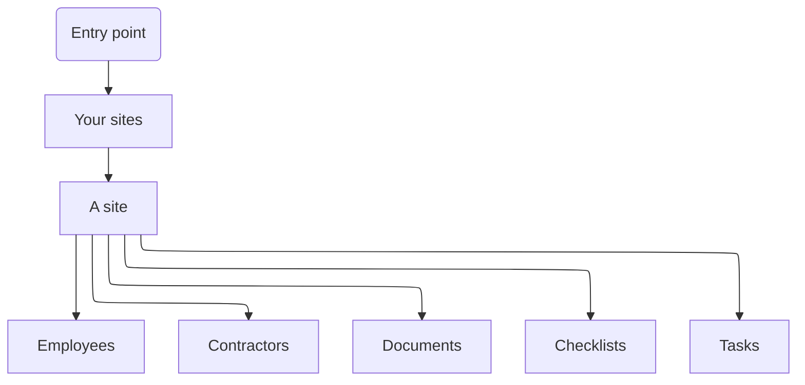

# API Overview
<span data-uuid="ba64778a-2578-4032-82b2-985a38d61db0" style="display:none"></span>

<style data-mb-hide-section-title>:is(h1,h2,h3):has(+ p + style[data-mb-hide-section-title]){display:none}</style>

<span data-uuid="c00c76d1-bee7-47bb-bd3d-2f051dae9a5a" style="display:none"></span>

<div class="grid" markdown>

<div style="align-self: center" markdown>

<span data-uuid="283cea1c-f0c6-4e0d-ae65-c44469008c7a" style="display:none"></span>

<span class="mb-label mb-label-cyan">Your compliance data, connected</span>

# Opus Compliance Cloud API

Connect Opus Compliance Cloud to the rest of your business. The API gives your systems secure, direct access to your compliance data, so records stay in step, reports build themselves and nobody has to key the same information in twice.

*Interested in the Opus Compliance Cloud API?*

<span data-uuid="25de2d15-17c8-4628-a265-c4fac25e26d6" style="display:none"></span>
[Contact us :lucide-send:](https://www.opus-safety.co.uk/contact){ .md-button .md-button--primary target="_blank" rel="noopener" }

</div>

<div style="align-self: center" markdown>

<span data-uuid="441c122f-39fa-4ec8-9b24-cd029ac58a57" style="display:none"></span>

<span data-uuid="0c6f54d0-a189-4617-a57a-621bd7df5407" style="display:none"></span>
```json title="An example site, as returned by the API"
{
  "slug": "head-office",
  "display_name": "Head Office",
  "_links": {
    "self":       { "href": "https://cloud.opus-safety.co.uk/sites/…" },
    "parent":     { "href": "https://cloud.opus-safety.co.uk/sites/…" },
    "employees":  { "href": "https://cloud.opus-safety.co.uk/sites/…/employees" },
    "documents":  { "href": "https://cloud.opus-safety.co.uk/sites/…/documents" },
    "checklists": { "href": "https://cloud.opus-safety.co.uk/sites/…/checklists" }
  }
}
```

</div>

</div>

## -
<span data-uuid="452457be-219e-436c-9198-abe06d0437d8" style="display:none"></span>

<style data-mb-hide-section-title>:is(h1,h2,h3):has(+ p + style[data-mb-hide-section-title]){display:none}</style>

---

## What is the Opus Compliance Cloud API?
<span data-uuid="db5a618b-090b-4399-bb2c-de982c19243e" style="display:none"></span>

The Opus Compliance Cloud API is a secure way for your own software to work with the data you hold in Opus Compliance Cloud. Anything from an HR system to a reporting dashboard can read your sites, employees, contractors, documents and tasks, and keep them up to date, without anyone signing in and clicking through the screens.

It is a **REST API** that speaks JSON over HTTPS, so it works with practically any modern language, integration platform or reporting tool.

## Who is it for?
<span data-uuid="03652a57-8be5-4d22-98c1-0b2e7dac3be7" style="display:none"></span>

The API is designed for organisations that want Opus Compliance Cloud to work as part of a wider set of systems, rather than alongside them. It is a good fit if you:

- manage starters and leavers in an HR or payroll system and want Opus Compliance Cloud to follow automatically
- report on compliance in a business intelligence tool, alongside the rest of your company data
- have an in-house development team, or an integration partner, building tools around your processes
- manage a large number of sites and want to make changes in bulk, consistently

## Features & Abilities
<span data-uuid="1ba0bd01-61a8-49ab-bcf9-14845ba0a133" style="display:none"></span>

<span data-uuid="2978f241-f983-4c37-9697-73eab32be15e" style="display:none"></span>

<div class="grid" markdown>

<div class="card" style="align-self: start" markdown>

<span data-uuid="5b148a6c-a460-4311-bf5d-5c040edcd3ce" style="display:none"></span>

<span class="mb-label mb-label-cyan">Keep your records in step</span>

---

Create and update sites, employees and contractors straight from the systems you already use. When someone joins, moves or leaves, Opus Compliance Cloud can follow without the double entry.

</div>

<div class="card" style="align-self: start" markdown>

<span data-uuid="02b908df-6327-474d-987a-d9bca3a8db19" style="display:none"></span>

<span class="mb-label mb-label-cyan">Report your way</span>

---

Pull tasks, checklists, documents and compliance report summaries into your own dashboards, and see compliance next to the rest of your business data.

</div>

<div class="card" style="align-self: start" markdown>

<span data-uuid="2b901156-87d5-4c03-b5fc-0334329d2883" style="display:none"></span>

<span class="mb-label mb-label-cyan">Easy to explore</span>

---

Every response links to the related records, so your integration finds its way around by following links. The built-in API viewer shows you the API behind the page you are looking at.

</div>

<div class="card" style="align-self: start" markdown>

<span data-uuid="3125b5e1-8571-4587-81c8-643c82fbcdc3" style="display:none"></span>

<span class="mb-label mb-label-cyan">Secure by design</span>

---

Every request is encrypted and signed with your own API key and secret. Your credentials are tied to a user in your organisation, so the API can only see and change what that user can.

</div>

<div class="card" style="align-self: start" markdown>

<span data-uuid="e8edf043-c269-43cf-b663-560550d057fa" style="display:none"></span>

<span class="mb-label mb-label-cyan">Built to last</span>

---

Each type of record has its own version number. When we improve one, the version you built against carries on working, so your integration is not broken by an update.

</div>

<div class="card" style="align-self: start" markdown>

<span data-uuid="10bf7682-dffc-404c-940a-1314a2e07668" style="display:none"></span>

<span class="mb-label mb-label-cyan">Safe updates</span>

---

Before saving a change, the API checks that the record has not been edited since you last read it, so an integration never silently overwrites someone else's work.

</div>

</div>

## How does it work?
<span data-uuid="d13627af-9a30-4546-b617-06930674767e" style="display:none"></span>

The Opus Compliance Cloud API follows the **HATEOAS** style of REST (*Hypermedia As The Engine Of Application State*). In practice, that means the API works like a website for software:

- You start at a single **entry point**.
- Every response includes a `_links` section, pointing to the related records and to the actions available on them.
- Your integration **follows those links**, instead of building web addresses itself.

<span data-uuid="059657df-a2db-45ad-8dcf-9fb68a43bfdf" style="display:none"></span>


Because your integration follows links, it keeps working as Opus Compliance Cloud grows, and it only ever discovers what your credentials allow it to see.

## Learn more
<span data-uuid="e5f8b50b-a211-4f60-8eb1-59d34814d7db" style="display:none"></span>

<span data-uuid="a28799da-a575-4425-b9f7-cdd82c6869a9" style="display:none"></span>

<div class="grid" markdown>

<div markdown>

<span data-uuid="711030bb-6740-47c7-bad6-b6dfd02785a7" style="display:none"></span>

<span data-uuid="30eeffcb-e82e-47ad-a0e8-f5236ce7d7e2" style="display:none"></span>
<div class="mb-nav-links" data-nav-path="guides/api"></div>

</div>

<div markdown>

<span data-uuid="153da817-8ae6-43dc-b2ca-a55ea2b658be" style="display:none"></span>

</div>

</div>
