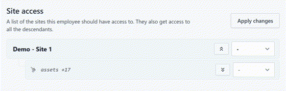
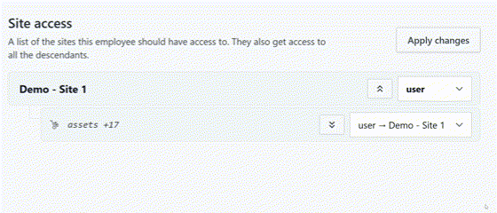

# Changing an employee's access

## Finding the employee

!!! step

    

    From [My Dashboard](https://cloud.opus-safety.co.uk/dashboard), click on **Pick workspace** and select the site where the employee is located.

    
    { style="height: 50px" loading=lazy }
    { style="height: 50px" loading=lazy }

!!! step

    

    From the site inbox page, click the **Switch to Manage Mode** button.

    
    { style="height: 50px" loading=lazy }
    { style="height: 50px" loading=lazy }

!!! step

    

    Click **Employee records** on the manage sidebar.

    
    { style="height: 50px" loading=lazy }
    { style="height: 50px" loading=lazy }

!!! step

    

    Find the employee from the list and click on their name

    
    { style="border-radius: 8px" width="500" loading=lazy }
    { style="border-radius: 8px" width="500" loading=lazy }

## Changing the employee's access

!!! step

    
    On the employee's record, select **Change access**

    
    { style="height: 50px" loading=lazy }
    { style="height: 50px" loading=lazy }

!!! step "(optional)"

    
    Under the **Authorisation & tags** section, modify the authorisations this employee holds *(you can only configure this if you possess the authorisation yourself)*.

    authorised/health — Assigning this tag grants the employee authorisation to access sensitive health data (e.g. Health Surveillance corrective actions) for the employees they manage.

    
    
    

    !!! note

        

        By default, all sites will have the `authorised/health` tag available, but depending on your site configuration you may have more.

!!! step "(optional)"

    
    Under the **Own employee record access** section, modify whether this employee can manage their own record.

    - :lucide-user: User - Can fulfil employee-scoped tasks such as their own e-learning completion. Cannot open their own confidential tasks unless assigned.
    - :lucide-user-shield: Manager - Can change their own requirements and deal with their own confidential tasks even when not assigned.
    - :lucide-user-cog: Administrator - Can make administrative-level changes to the employee record, such as adding requirements to their roles.

    
    
    

!!! step

    
    Under the **Site access** section, modify the employees access to your site(s).

    *:lucide-info: Select between **:lucide-user: User**, **:lucide-user-shield: Manager** and **:lucide-user-cog: Administrator** access. To remove access to a site, select the - option from the dropdown menu.*

    
    

    !!! info "Multi-sited?"

        
        You can navigate up and down your site hierarchy using the :lucide-chevron-up-square: Up and :lucide-chevron-down-square: Down arrow buttons to set access to other sites/regions, or your entire organisation.

        
        

    !!! tip

        

        Access cascades down the site hierarchy. Granting access at a site automatically applies the same access to all of its sub-sites.

!!! step

    

    Once you have made the changes, click **Apply changes**.

    
    { style="height: 50px" loading=lazy }
    { style="height: 50px" loading=lazy }