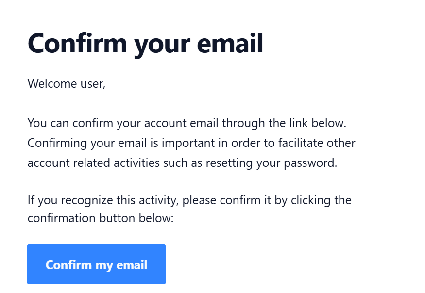

# Creating & linking your Opus Account

Follow this guide to help you with creating and/or linking your Opus Account. 

*:lucide-info: This guide assumes you have already received a registration link or QR code from the relevant manager. If you have not received one, please refer them to [this guide](registering-an-employee.md) for instructions on how to provide it to you.*

## Account setup

=== "New Opus User"

    

    
    **Follow the steps below to create a new Opus account and complete registration.**

    !!! step

        

        
        After following the link or scanning the QR code, you will be asked to confirm that you are linking to the correct employee record. Please ensure that your name is displayed on the confirmation page.

        **If your name is not shown**, you may have been provided with an incorrect registration link or QR code. In this case, **do not proceed** and contact the person who provided it to you immediately.

        
        { style="border-radius: 8px" width="400" loading=lazy }
        { style="border-radius: 8px" width="400" loading=lazy }

    !!! step

        

        
        Click **Sign up**

        
        
        

    !!! step

        

        
        Create your Opus account using an email and password.

        
        { style="border-radius: 8px" width="400" loading=lazy }
        { style="border-radius: 8px" width="400" loading=lazy }

    !!! step ":lucide-triangle-alert: Important! Do not skip."

        

        
        You will now see a Link Confirmation page displaying your name. Click **Link My Opus Account** to continue.

        
        
        

    !!! step

        

        
        After registering, you will receive an email confirmation. Click the **Confirm my email** button in your email.

        
        { style="border-radius: 8px" width="400" loading=lazy }

=== "Existing Opus User"

    

    
    **Follow the steps below to complete registration with an existing Opus account.**

    !!! step

        

        
        After following the link or scanning the QR code, you will be asked to confirm that you are linking to the correct employee record. Please ensure that your name is displayed on the confirmation page.

        **If your name is not shown**, you may have been provided with an incorrect registration link or QR code. In this case, **do not proceed** and contact the person who provided it to you immediately.

        
        { style="border-radius: 8px" width="400" loading=lazy }
        { style="border-radius: 8px" width="400" loading=lazy }

    !!! step

        

        
        Click **Sign in**

        
        
        

    !!! step

        

        
        Sign in with your existing Opus account.

        
        { style="border-radius: 8px" width="400" loading=lazy }
        { style="border-radius: 8px" width="400" loading=lazy }

        !!! question "Forgot your password?"

            

            
            Use the [Forgot your password?](https://cloud.opus-safety.co.uk/users/password/new) link and follow the instructions to reset your password.

    !!! step ":lucide-triangle-alert: Important! Do not skip."

        

        
        You will now see a Link Confirmation page displaying your name. Click **Link My Opus Account** to continue.

        
        
        

## Configuring your profile, subscriptions and notifications.

If you’re a new user, you’ll be guided through the subscription wizard immediately after linking. You can re-run the wizard at any time via your subscription settings or directly below.

[Run the subscription wizard :lucide-arrow-up-right:](https://cloud.opus-safety.co.uk/my/subscriptions/wizard){ .md-button .custom-button-emerald .custom-button--slim target="_blank" rel="noopener" }

[Step-by-step instructions :lucide-arrow-right:](https://support.opus-safety.co.uk/pages/subscriptions/#2d46c4ff-e2d5-4a0b-a892-7290840b4106){ .md-button .custom-button-cyan .custom-button--slim }

